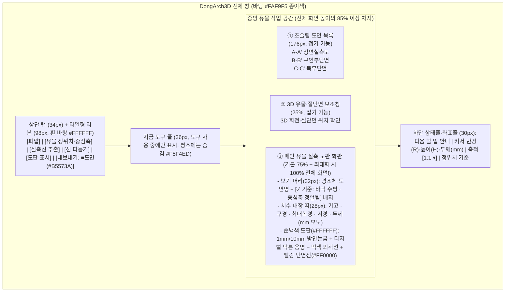

# DongArch3D UI/UX 최종 설계도 — 「조용한 유물 도판 (Strata for Artifacts)」

> [!IMPORTANT]
> **설계 핵심 목표**
> 1. **`D:\desca`의 Strata 「조용한 도판」 디자인 양식 100% 계승**: 따뜻한 보고서 종이 바탕(`#FAF9F5`), 순백색 도판(`#FFFFFF`), 먹색 선과 글자(`#141413`), 화면당 단 하나만 쓰는 흙색 주 단추(`#B5573A`), 3단계 도구 상태(먹색 손에 든 도구 / 귀리색 켜짐 토글 / 책상색 대기 타일)를 그대로 적용합니다.
> 2. **기존 참고 문헌(Arch3D Liner) 완전 배제**: 복잡하고 어지러운 상용 프로그램식 분할·다중 Dock 패널을 버리고, 처음부터 **유물 실측 본질**에 맞춰 설계합니다.
> 3. **유물과 실측 도면이 주인공 (화면의 75% ~ 100% 도판 극대화)**: 기존 `DongArch3D`에서 화면을 가리던 좌·우·하단 3개 대형 Dock 패널을 제거하고, **유물 실측 도판(1:1 mm 방안 도면)이 화면에서 압도적으로 가장 크게** 보이도록 배치합니다.

👉 **[인터랙티브 화면 목업 열기 (dongarch3d_mockup.html)](file:///C:/Users/kyi25/.gemini/antigravity/brain/9441b7ba-89f5-45d2-b269-088df839338b/dongarch3d_mockup.html)** 에서 4가지 핵심 화면을 직접 클릭하며 확인하실 수 있습니다.

---

## 1. 본질 분석: 유물을 실측으로 그릴 때 무엇이 필요하고, 무엇이 중심이어야 하는가?

`D:\desca`는 **발굴 조사구역·토층(m 단위, GPS 좌표계 EPSG, 해발고도 EL.)**을 다루지만, 우리가 만드는 앱은 **출토된 개별 유물(토기·석기·기와·청자·금속기 — mm 단위)**을 다룹니다. 따라서 고고학자가 유물 실측 도면을 그릴 때 반드시 필요한 **5가지 핵심 요소**를 중심으로 `D:\desca`의 양식을 유물 맞춤형으로 재해석했습니다.

| 구분 | `D:\desca` (유구·토층 단면뷰어) | `DongArch3D` (유물 실측 도판 프로그램 — 신규 설계) | 왜 유물 실측에 필수적인가? |
| :--- | :--- | :--- | :--- |
| **① 절대 기준 (상단 배지 & 상태줄 고정)** | 수평 좌표계(`EPSG:5186`) · 높이 기준(`EGM96`) | **유물 정위치 기준**: `✓ 바닥 수평(0 mm) · 회전 중심축 정렬됨` (또는 `구연부 수평 기준`) | 유물은 땅에 묻혀 있을 때 기울어져 있으므로, **바닥(저부)이나 입구(구연부)를 수평 0 mm로 맞추고 좌우 대칭 회전 중심축을 잡는 것**이 실측의 첫걸음이자 생명입니다. |
| **② 배경 눈금과 단위** | 표고(m) 레벨선 (`10 cm` 선 / `50 cm` 숫자) | **실측 방안 눈금 (`1 mm` 세선 / `10 mm(1 cm)` 주선 / `50 mm` 숫자)** + **정중앙 중심축선** | 유물 실측도는 실제 모눈종이(방안지)에 1 mm 단위로 그립니다. 바닥(`H 0 mm`)과 중심축(`R 0 mm`)을 기준으로 눈금이 깔려야 실측자가 눈으로 즉시 크기를 가늠합니다. |
| **③ 도면 표현 양식 (그리는 순서)** | 레벨선 → 정사영상 → 단면선(빨강 `#FF0000`) | **방안눈금 → 유물 음영(디지털 탁본 D-Tak / 깊이 음영) → 외곽선·능선(먹색 `#141413`) → 단면선(순수 빨강 `#FF0000`)** | **토기(회전체)**는 중심선 기준 **좌측은 기벽 종단면(빨강), 우측은 외곽선+문양 탁본(먹색)**으로 결합하는 것이 한국 고고학 보고서의 표준 도판 양식입니다. **석기·기와(비대칭)**는 **정면·측면·배면·단면 4면 전개도**로 한눈에 보여줍니다. |
| **④ 핵심 계측 수치 (수치 대장 띠)** | 단면 길이(m) · 앞/뒤 깊이(m) · 세로:가로 비율 | **유물 5대 치수 자동 대장**: `기고(높이)` · `구경(입지름)` · `최대복경(몸통)` · `저경(바닥)` · `평균 기벽두께` (모두 `mm` 모노 글꼴) | 별도의 넓은 측정 결과 창으로 화면을 가릴 필요 없이, 도판 머리 바로 아래 `28 px` 얇은 정보 띠(`#F5F4ED`)에 5대 필수 치수를 상시 표시하고 마우스를 대면 해당 부위 치수가 풍선으로 뜹니다. |
| **⑤ 최종 산출물 (`[도면]` 주 단추)** | A4/A3 축척(`1:20`, `1:40`) PDF · DXF | **1:1 실제 크기(`1:1`, `1:2`, `1:3`, `2:1`) 일러스트레이터 레이어 분리 SVG** · 보고서 도판 PDF · CAD DXF | 유물 실측자는 추출된 선을 **Adobe Illustrator**로 가져가 마감합니다. 단면선·외곽선·중심축·탁본영상·눈금이 **각각 독립된 레이어**로 묶여 **1:1 실제 mm 치수**로 내보내져야 합니다. |

---

## 2. 화면 공간 배분 설계: "유물과 도면이 보이는 곳을 최대한 크게!"

기존 `DongArch3D`의 가장 큰 문제였던 **좌측 20버튼 도구함 + 우측 속성창 + 하단 측정표(화면의 45% 잠식)**를 전면 폐기하고, `D:\desca`처럼 **상단 슬림 리본 + 중앙 대화면 도판** 구조로 개편합니다.

### 공간 극대화 핵심 장치 3가지
1. **원클릭 `도면 100% 최대화` (`□` 단추 또는 `Tab` 키)**:
   - 단면선 추출이 끝나고 도면을 세밀하게 다듬을 때는 좌측 `실측 도면 목록(176px)`과 `3D 유물 보조창(25%)`을 한 번에 접어, **유물 실측 도판이 모니터 화면의 100% 전체를 꽉 채우도록** 설계했습니다.
2. **우측 속성 패널·하단 측정 테이블 완전 제거 → `28px 치수 대장 띠` + `커서 풍선`으로 통합**:
   - 기고·구경·저경·최대복경·기벽두께는 도판 상단의 얇은 1줄 띠(`infoStrip`, 28px)에 고정 표시하여 도면 면적을 전혀 뺏지 않습니다.
   - 특정 부위의 두께나 지름을 잴 때는 도판 위에서 마우스를 올리거나 두 점을 찍으면 `D:\desca`처럼 깔끔한 흰색 모노 풍선(`기벽 두께 6.8 mm / 높이 H 95.0`)이 도면 위에 뜹니다.
3. **상황별 도구 줄 (`ctxBar`, 36px)**:
   - 평소에는 숨겨져 있다가 `단면선`, `중심축 맞춤`, `자르기` 같은 도구를 손에 들었을 때만 리본 아래에 나타나 조작법(`Shift` 수평 고정, `[` `]` 1mm 이동)을 알려주고, 도구를 내려놓으면 즉시 사라져 도면 영역을 넓혀줍니다.

---

## 3. `D:\desca` 디자인 토큰 및 시각 규격 (1:1 완전 일치)

[`D:\desca\research\ui-ref\UI-SPEC.md`](file:///D:/desca/research/ui-ref/UI-SPEC.md) 및 [`D:\desca\app\theme.hpp`](file:///D:/desca/app/theme.hpp)의 모든 색상·글꼴·반지름·간격 규칙을 `DongArch3D`에 그대로 이식합니다.

### 3.1 색상 팔레트 (어두운 테마 없음 — 「조용한 도판」 단일 라이트 테마 + 햇빛 고대비 모드)
| 분류 | 토큰 이름 | Hex 값 | `DongArch3D` 적용 위치 |
| :--- | :--- | :--- | :--- |
| **종이 바탕** | `Ground` / `Surface` | `#FAF9F5` / `#FFFFFF` | 앱 전체 기본 바탕(`#FAF9F5`), 리본·도판 캔버스·카드·입력칸(`#FFFFFF`) |
| **보조 면** | `Wash` / `Desk` / `Press` | `#F5F4ED` / `#F0EEE6` / `#E8E6DC` | 치수 대장 띠·지금 도구 줄(`#F5F4ED`), 쉬는 리본 타일(`#F0EEE6`), 누름 상태(`#E8E6DC`) |
| **켜짐 면** | `Oat` | `#E3DACC` (테 `#B0AEA5`) | **켜진 표시 토글** (유물 음영 켜짐, 단면·외곽 켜짐, 방안 눈금 켜짐, 선택된 축척 칩) |
| **손에 든 도구** | `Hand` | `#30302E` (글자 `#FAF9F5`) | **현재 마우스로 조작 중인 도구** (단면선 그리기 중, 중심축 맞추기 중, 거리 재기 중) |
| **주 단추 (유일)** | `Action` | **`#B5573A`** (호버 `#A44D32`) | **한 화면에 딱 한 곳!** 리본의 **`[도면]`** 타일, 대화상자의 **`[SVG / 도면 저장]`** 단추에만 사용 |
| **먹색 글자** | `Ink` / `Ink2` / `Muted` | `#141413` / `#3D3D3A` / `#5E5D59` | 본문·제목·초점 테두리(`#141413`), 보조 수치(`#3D3D3A`), 라벨·설명(`#5E5D59`) |
| **실측 데이터 색** | `ProfileRed` / `OuterInk` | **`#FF0000`** / **`#141413`** | **절단 단면선(`#FF0000` 순수 빨강, 3D 뷰에서는 흰 테 3px Halo 포함)**, **외곽선·중심축(`#141413` 먹색)** |
| **방안 눈금 색** | `Grid1mm` / `Grid10mm` | `#EDEBE2` / `#D5D2C6` | 도판 맨 뒤에 깔리는 1 mm 세선(`0.75px`)과 10 mm(1 cm) 주선(`1.0px`) |

### 3.2 글꼴 체계 (역할별 3종 분리)
1. **명조 (`Noto Serif KR` 500, 18~28px)**: 유물 도면 제목 (`A–A′ 정면 실측도`, `구석기_주먹도끼_04호`), 시작 화면의 이어서 작업할 유물 이름.
2. **모노 (`Consolas` / `JetBrains Mono` 400, 11~20px)**: 모든 계측 수치(`기고 184.5 mm`, `구경 142.0 mm`), 방안 눈금 숫자(`0, 50, 100, 150`), 하단 커서 좌표(`R -82.6 mm  H 95.0 mm`), 단축키 배지(`kbd`). **숫자는 항상 오른쪽 맞춤, 단위(`mm`)는 회색(`#73726C`)**으로 표기합니다.
3. **고딕 (`Malgun Gothic` / `Noto Sans KR` 400, 기본 13px)**: 리본 타일 이름, 메뉴, 안내 문장, 버튼.

---

## 4. 핵심 화면 4종 상세 설계

### 화면 ①: 주 작업 화면 — 회전체 유물(토기·도자기) 좌단면·우외곽 통합 도판
- **리본 구성 (5개 탭: `파일` · `홈` · `정위치·중심축` · `측정·탁본` · `내보내기`)**:
  - **파일**: `열기` (`Ctrl+O`), `최근 ▾`
  - **유물 정위치 · 중심축**: `중심축 맞춤` (큰 타일), `바닥 수평 맞춤 (B)`, `구연부 수평 맞춤 (T)`, `정면 회전 ±1° (, .)`
  - **실측선 추출**: `단면선 (S)`, `외곽선 (O)`, `좌단면·우외곽 결합 (토기 표준)`, `절단 위치 이동 [ ]`, `단면 추가 (N)`
  - **선 다듬기 · 간략화**: 간략화 칩 `[0.1][0.3][0.5 mm][1.0]` (Douglas-Peucker), 곡선 칩 `[원본][매끄럽게(Catmull)]`
  - **도판 표시 (겹침)**: `유물 음영 (I)` (실사 / 깊이 음영 / **디지털 탁본 D-Tak** 전환), `단면·외곽 (L)`, `방안 눈금 (V)` (`1mm / 10mm`)
  - **내보내기**: **`■ 도면` (`#B5573A` 유일한 흙색 타일, `Ctrl+P`)**, `SVG 일러스트`, `DXF`
- **메인 도판 뷰 (`view-sheet`)**:
  - 정중앙 세로 중심축(`0 mm`)을 기준으로 **왼쪽 절반에는 순수 빨강(`#FF0000`) 기벽 종단면선과 내면 물레 흔적**, **오른쪽 절반에는 먹색(`#141413`) 외곽선과 디지털 탁본(D-Tak) 문양 음영**이 결합되어 즉시 보고서 도판 형태로 그려집니다.

### 화면 ②: 비대칭 유물(석기·기와·금속기) 4면 전개 실측 도판
- 토기처럼 회전 대칭이 아닌 석기·기와·철기 유물은 상단에서 **`[4면 전개 모드]`**를 켜면:
  - 하나의 넓은 방안 도판 위에 **정면도(Front) + 우측면·종단면(Side) + 배면도(Back) + 수평 횡단면(B–B′)**이 수평 기준선을 맞춰 나란히 자동 정렬됩니다.
  - 석기의 박리 능선(Ridge)과 표피(Cortex) 경계선이 먹색 세선으로 함께 추출되어 손으로 일일이 능선을 따라 그리는 시간을 80% 이상 단축합니다.

### 화면 ③: 도면 · 일러스트(SVG) 내보내기 미리보기 창 (`L 860` 규격)
- `D:\desca`의 `단면도 내보내기` 창과 동일한 좌·우 분할 미리보기 대화상자입니다.
- **왼쪽 (용지 실제 비율 미리보기)**:
  - 선택한 용지(`A4 세로`, `A4 가로`, `A3`) 안에 유물이 선택한 축척(`1:1 실제 크기`, `1:2`, `1:3`, `2:1 확대`)으로 어떻게 배치되는지 표제란·축척 막대와 함께 실시간으로 보여줍니다.
  - 유물이 용지보다 크면 **`▲ 1:1에서 유물 높이 340 mm는 A4 세로 한 장을 넘습니다. 추천: 1:2로 줄이거나 A3 세로 선택`** 안내가 자동으로 뜹니다.
- **오른쪽 (설정 및 레이어 순서)**:
  - `SVG (일러스트 1:1)` / `PDF (보고서 도판)` / `DXF (CAD)` / `PNG` 선택
  - 일러스트레이터(SVG) 저장 시 **`단면선(#FF0000)` / `외곽선(#141413)` / `능선·문양` / `중심축·보조선` / `디지털 탁본 영상` / `방안 눈금·표제란`**이 각각 독립 레이어로 분리되어 저장됩니다.

### 화면 ④: 시작(홈) 화면 (`startPage`)
- 프로그램을 켜면 빈 회색 창이 아니라 `D:\desca`와 동일한 **「조용한 도판」 홈 화면**이 열립니다.
- **이어서 작업 카드**: 방금 작업하던 유물의 명조체 큰 제목, 마지막 작업 시각, 저장된 단면 슬롯 개수, 5대 치수, 정위치 정렬 상태를 보여주고 **`[이어서 열기 →]`** 흙색 단추 하나로 즉시 이전 작업 화면을 복원합니다.
- **최근 실측 유물 삼선표** 및 **파일 끌어놓기(`PLY · OBJ · STL`)** 영역, 우측의 **`세 걸음으로 유물 실측도 완성`** 안내 카드로 비숙련 조사원도 5분 안에 익힐 수 있습니다.

---

## 5. 기존 코드(`GigaMesh/gui`) 대비 변경·구현 범위 요약

이 설계도가 승인되면 다음 순서로 실제 C++/Qt 코드에 적용됩니다:
1. **`DongArchTheme.h` / `strata_artifact.qss` 적용**: 기존 다크모드(`modern_dark.qss`)와 알록달록한 색상을 제거하고 `D:\desca`의 `theme.hpp` 토큰(`#FAF9F5`, `#141413`, `#B5573A`, `#E3DACC`, `#30302E`) 및 단색 선 아이콘으로 전면 교체.
2. **3대 대형 Dock 패널 제거 & 대화면 분할 뷰(`QSplitter`) 재구성**:
   - 기존의 20버튼 `DongArchToolPalette` Dock, `DongArchPropertyPanel` Dock, `DongArchMeasurementPanel` Dock을 제거.
   - 상단 타일형 리본(`ribbon`) + 상황별 도구 줄(`ctxBar`) + 초슬림 슬롯 목록(`176px`) + 3D 보조 뷰(`25%`) + **메인 유물 실측 도판 뷰(`75%~100%`)** + 하단 치수·좌표 상태줄로 메인 윈도우 재구성.
3. **실측 도판 전용 뷰포트(`DongArchSheetView`) 및 `L 860` 도면·SVG 미리보기 창 연결**:
   - 기존에 구현된 Cutline(단면), Outline(외곽), D-Tak(탁본), SVGExporter 엔진을 새 도판 뷰와 내보내기 미리보기 창에 직결.
